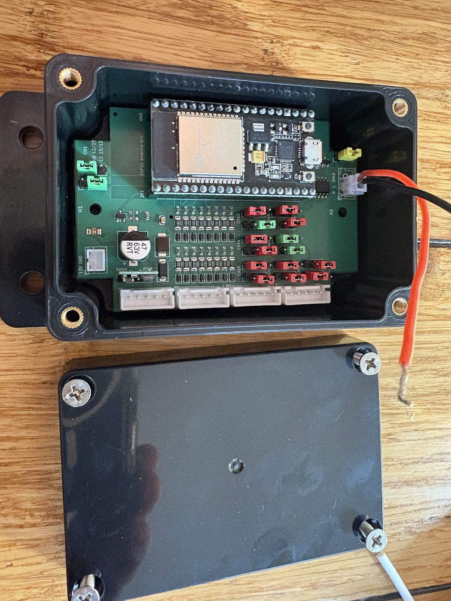
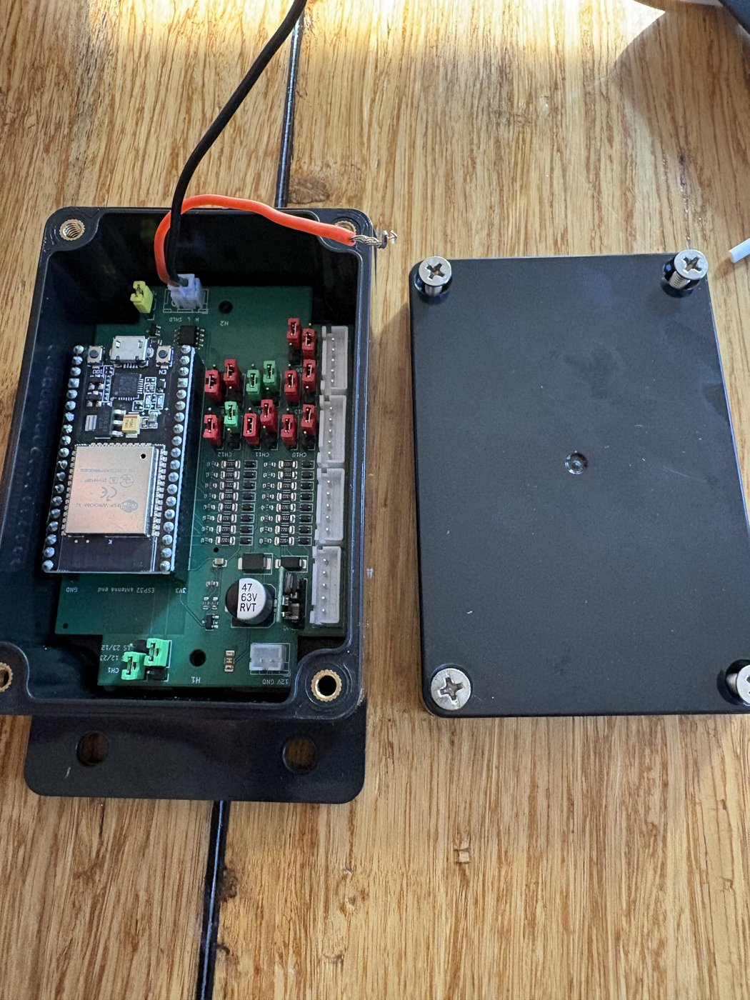
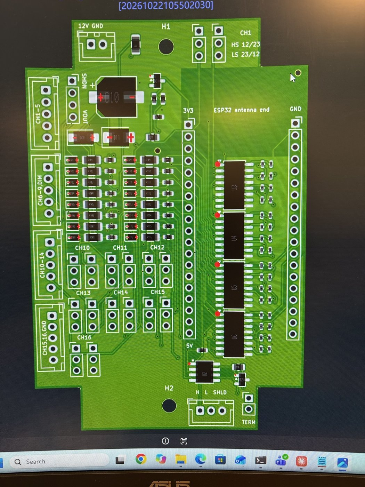
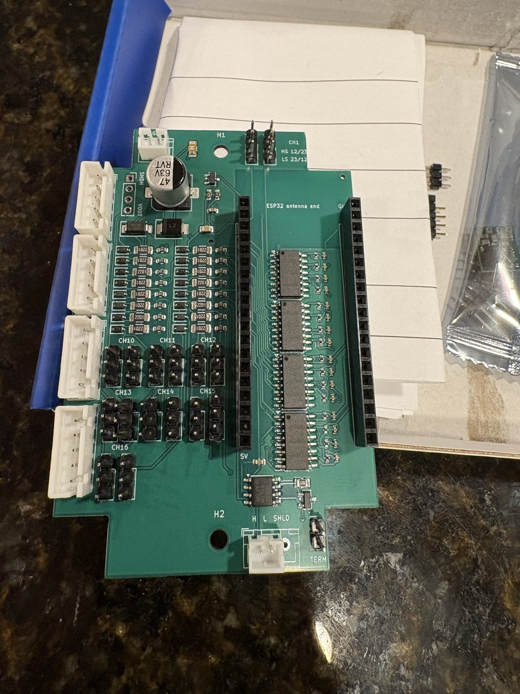
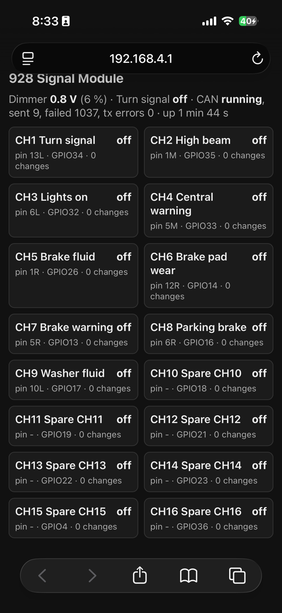
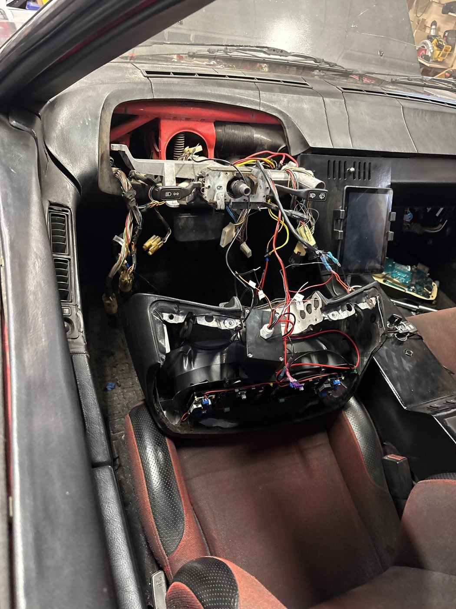

# 928 Signal Board

A CAN bus signal module for a Porsche 928 electric conversion. It reads the
original instrument cluster's 12 V warning-light and indicator signals (turn
signal, high beam, lights on, brake warnings, washer fluid and more), plus the
dash-dimmer voltage, and sends them all on the EV's CAN bus in one frame. A
modern dash display can then show the car's original warning lights.

Rev A is built, bench tested and installed in an '81 928, where it feeds the turn signal, high beam, lights-on and dimmer to the 928 EV dash ([928EVDASH](https://github.com/bapshago/928EVDASH), v1.1 and later).

## Features

- **16 isolated inputs** through optocouplers, each protected by a series diode:
  - 2 high-side channels (active at +12 V), 6 low-side (active when grounded),
  - 8 "universal" channels set high- or low-side with jumpers.
- **Dash-dimmer input** (0-14 V analog) for backlight brightness.
- **CAN at 500 kbit/s** (SN65HVD230), with an on-board 120 ohm terminator on a jumper.
- **Automotive power input:** 1 A fuse, reverse-polarity diode, 24 V TVS, and a
  Pololu D36V6F5 12 V to 5 V regulator module.
- **ESP32 (38-pin DevKit)** in sockets, with firmware that serves a **Wi-Fi status
  page**: live inputs, dimmer voltage and CAN status on your phone, no cable needed.
- **Settings over Wi-Fi:** CAN ID, frame rate, CAN mode (send / listen only / off),
  Wi-Fi name and password. Firmware updates over Wi-Fi too.
- **Bus-safe CAN behaviour:** single-shot frames (never floods the bus), listens
  before sending, stops on an ID conflict, and backs off after bus-off.
- 60 x 90 mm board with notched corners, made to fit a common 100 x 68 x 50 mm
  project box (see [Enclosure](#enclosure)).

## Repository layout

| Folder | Contents |
|---|---|
| [`hardware/`](hardware/) | Gerbers, BOM and CPL for ordering at JLCPCB, the KiCad board, board outline (DXF), pin-outs, jumper settings and bring-up steps |
| [`firmware/signal_module_928/`](firmware/signal_module_928/) | Arduino sketch for the ESP32, with setup, upload and CAN frame details |
| [`firmware/test/`](firmware/test/) | PC test harness for the firmware (`run_tests.sh`, needs g++) |
| [`tools/`](tools/) | Bench tools: a CAN monitor sketch for a second ESP32, and a CAN transceiver test |
| [`docs/images/`](docs/images/) | Photos and the board layout |

## Quick start

1. **Order the board:** follow [`hardware/README.md`](hardware/README.md#ordering-at-jlcpcb).
   JLCPCB assembles all the surface-mount parts; you solder the connectors,
   sockets and jumper headers.
2. **Bring it up on the bench:** follow the [bring-up steps](hardware/README.md#bring-up)
   (12 V supply with a current limit, then the regulator, then the ESP32).
3. **Flash the firmware:** see [`firmware/signal_module_928/README.md`](firmware/signal_module_928/README.md).
4. **Join the Wi-Fi network** `928-Signal-Module` (default password `porsche928`)
   and open http://192.168.4.1. **Change the password** on the settings page.
5. **Wire it to the car:** power from the cluster's switched 12 V (3R) and ground (9R),
   inputs from the cluster plugs (pin-out in the hardware README), and CAN-H/CAN-L
   to the EV CAN bus. Remove the JP10 terminator, since the car's bus already has its two.

## CAN frame (default ID 0x31B, 500 kbit/s)

Sent every 100 ms, and immediately when an input changes.

| Byte | Content |
|---|---|
| 0 | CH1-CH8, bit 0 = CH1 ... bit 7 = CH8, 1 = active |
| 1 | CH9-CH16, bit 0 = CH9 ... bit 7 = CH16 |
| 2-3 | Dash dimmer voltage, little-endian, 0.1 V per bit |
| 4 | Dash dimmer level, 0-100 % of 14.0 V |
| 5 | Rolling counter, +1 per frame |
| 6 | Flags: bit 0 = turn signal flashing |
| 7 | Frame layout version (1) |

Full details and a sample decoder are in the [firmware README](firmware/signal_module_928/README.md).

## Enclosure

The board fits a 100 x 68 x 50 mm plastic project box with a screw-down lid and
mounting flanges, available here: https://a.co/d/0giEBknB

- Inside: about 88 x 56 mm. The board's 10 x 10 mm corner notches clear the box's
  corner screw bosses.
- The board's two M3 holes, 79 mm apart on its centre line, line up with the box's
  two internal standoffs.
- Cables: the first build has a cable gland drilled through the **lid**, with all the
  wiring (power, inputs and CAN) running out through it. A gland in the lid keeps the
  box sealed and leaves the sides free for mounting; the connectors face up, so the
  wires route straight to it. Leave enough slack to open the lid with the plugs fitted.

## Build photos

| | |
|---|---|
|  |  |
| Layout in JLCPCB's viewer | As delivered, with connectors, sockets and jumper headers soldered |
|  |  |
| The Wi-Fi status page (bench testing, before a second CAN node was connected) | In the '81's instrument pod during the install, cable gland through the lid |

## License

This project (hardware, firmware and documentation) is licensed under the
[Creative Commons Attribution-NonCommercial-ShareAlike 4.0 International License](LICENSE)
(CC BY-NC-SA 4.0). You may use, copy, modify and share it for **non-commercial**
purposes, with attribution, and share your changes under the same license.
Commercial use, including selling boards or kits, is not permitted without
permission.
