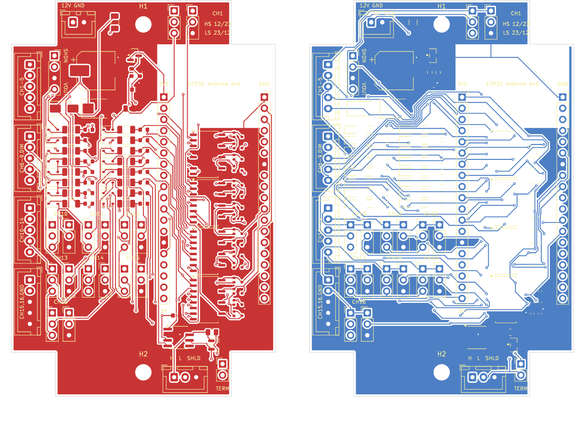

# 928 Signal Board: hardware, rev A

60 x 90 mm, 2 layers, 1.6 mm, with 10 x 10 mm corner notches and two M3 holes 79 mm
apart on the centre line. JLCPCB assembles every surface-mount part on the top side;
you solder the through-hole connectors, sockets, jumper headers and the two plug-in
modules.

## Files

| File | Use |
|---|---|
| [`jlcpcb/928-signal-board-rev-a-gerbers.zip`](jlcpcb/928-signal-board-rev-a-gerbers.zip) | The board itself: upload as the PCB |
| [`jlcpcb/928-signal-board-rev-a-bom.csv`](jlcpcb/928-signal-board-rev-a-bom.csv) | Assembly BOM: every SMD part with its LCSC part number |
| [`jlcpcb/928-signal-board-rev-a-cpl.csv`](jlcpcb/928-signal-board-rev-a-cpl.csv) | Assembly placement (CPL), with the rotations already corrected for JLCPCB's part models |
| [`kicad/928-signal-board.kicad_pcb`](kicad/928-signal-board.kicad_pcb) | The board in KiCad 9, to inspect or modify |
| [`928-signal-board-outline.dxf`](928-signal-board-outline.dxf) | Board outline and mounting holes only, for enclosure work |

The BOM and CPL are the ones the first boards were assembled from. The rotation fixes
JLCPCB's placement preview needed on that first order (the SOIC and SOT-23 parts) are
already in the CPL.

## Ordering at JLCPCB

1. Upload the Gerber zip. 2 layers, 1.6 mm, any colour. ENIG is easier to hand-solder.
2. Turn on **PCB Assembly**, top side, and upload the BOM and CPL.
3. Every BOM line carries an LCSC part number. If one is out of stock, pick an
   equivalent with the same value and package in JLCPCB's BOM tool.
4. Check the placement preview: pin 1 of the four optocouplers (U3-U6), the CAN
   transceiver U2, the SOT-23 parts (D3, D12) and the polarity of C10 (47 uF
   electrolytic), D10 (SS34) and D11 (TVS).

## Parts you solder yourself

| Ref | Qty | Part |
|---|---|---|
| J1 | 1 | JST XH 2-pin header, vertical (B2B-XH-A): power |
| J2 | 1 | JST XH header for CAN: 3-pin (B3B-XH-A) for H, L and shield drain, or a 2-pin in the H/L positions with the drain soldered into the SHLD hole if used |
| J3-J6 | 4 | JST XH 5-pin header, vertical (B5B-XH-A): inputs |
| J7, J8 | 2 | 1x19 female header, 2.54 mm: sockets for the ESP32 board |
| J9 | 1 | Pololu D36V6F5 (12 V to 5 V, 600 mA): solder directly or use a 1x4 female header |
| JP10 | 1 | 1x2 pin header + shunt: CAN terminator |
| JP101, JP201, JP110-JP116, JP210-JP216 | 16 | 1x3 pin header + shunt: universal-channel jumpers |
| U1 | 1 | ESP32 DevKit, **38-pin** (ESP-WROOM-32), header rows **22.86 mm (0.9 in)** apart, DevKitC V4 pinout |

Solder the ESP32 sockets with the ESP32 board plugged in, so they line up. Check the
Pololu's orientation twice before soldering it: its **SHDN** pin goes to the end of
J9 marked SHDN, **VOUT** to the end marked VOUT. Pads joined to the ground plane need
a hot iron (350 °C or more).

## Pin-outs

All connectors are JST XH, **pin 1 = square pad**.

**J1 power** (top edge, "12V GND")
| Pin | Signal | 928 cluster |
|---|---|---|
| 1 | +12 V switched | 3R |
| 2 | GND | 9R |

**Inputs J3-J6** (one edge, J3 nearest J1)
| Connector pin | Channel | 928 cluster pin | Active when |
|---|---|---|---|
| J3-1 | CH1 Turn signal | 13L | jumpers: high-side = +12 V, low-side = GND |
| J3-2 | CH2 High beam | 1M | +12 V |
| J3-3 | CH3 Lights on | 6L | +12 V |
| J3-4 | CH4 Central warning | 5M | GND |
| J3-5 | CH5 Brake fluid | 1R | GND |
| J4-1 | CH6 Brake pad wear | 12R | GND |
| J4-2 | CH7 Brake warning | 5R | GND |
| J4-3 | CH8 Parking brake | 6R | GND |
| J4-4 | CH9 Washer fluid | 10L | GND |
| J4-5 | DIM dash dimmer (analog, 0-14 V) | 14R | voltage |
| J5-1 ... J5-5 | CH10-CH14 spare | - | jumpers |
| J6-1, J6-2 | CH15, CH16 spare | - | jumpers |
| J6-3, J6-4, J6-5 | GND | | |

Each input is optocoupler-isolated with a series diode, so touching an input with the
"wrong" voltage does nothing.

**J2 CAN**
| Pin | Signal |
|---|---|
| 1 | CAN-H |
| 2 | CAN-L |
| 3 / SHLD | GND (shield drain; ground the shield at this end only) |

## Jumpers

**Universal channels (CH1, CH10-CH16):** two 1x3 headers per channel, JP1 on the left
and JP2 on the right, pin 1 at the top (silkscreen "HS 12/23" and "LS 23/12" on CH1).

| Mode | JP1 | JP2 | Active when |
|---|---|---|---|
| High-side | 1-2 | 2-3 | input at +12 V |
| Low-side | 2-3 | 1-2 | input grounded |
| Unused | none | none | never |

Never put a shunt across the two headers: their pin 3s are +12 V and GND.

**JP10, CAN terminator (120 ohm):** fit it on the bench when the board is one end of a
short test bus; **remove it in the car**, where the bus already has its two terminators.

## ESP32 pin map

| Signal | GPIO | Socket pin |
|---|---|---|
| CH1-CH9 | 34, 35, 32, 33, 26, 14, 13, 16, 17 | J7-5, J7-6, J7-7, J7-8, J7-10, J7-12, J7-15, J8-12, J8-11 |
| CH10-CH16 | 18, 19, 21, 22, 23, 4, 36 | J8-9, J8-8, J8-6, J8-3, J8-2, J8-13, J7-3 |
| DIM | 39 (ADC1) | J7-4 |
| CAN TX / RX | 27 / 25 | J7-11 / J7-9 |
| 5V in / 3V3 out / GND | | J7-19 / J7-1 / J7-14, J8-1, J8-7 |

Inputs read **low when active** (10k pull-ups to 3.3 V on the board). The dimmer goes
through a 47k/10k divider; 14.4 V at the input is about 2.5 V at the ADC.

## Bring-up

1. **Visual check**, then solder the through-hole parts (above).
2. **Bare board on a bench supply:** 12 V with a **100 mA current limit**, before the
   Pololu and ESP32 are fitted. Only a few mA should flow. Reversed polarity is blocked
   by the SS34 diode.
3. **Fit the Pololu:** check for 5 V at the ESP32's 5V pin (J7-19) before the ESP32 goes in.
4. **Fit the ESP32** (3V3 at the top of the left socket, J7-1) and raise the current
   limit to **300 mA**: Wi-Fi start-up draws peaks that a 100 mA limit turns into resets.
   Expect about 60-70 mA at 12 V with Wi-Fi on.
5. **Flash the firmware** over USB with the 12 V off. Use USB and 12 V together only if
   your ESP32 board has a diode between USB 5 V and its 5V pin: with the ESP32 on USB
   alone, VIN should read about 4.6-4.8 V (diode) rather than 5.0 V (no diode).
6. **Inputs:** join the Wi-Fi network and open http://192.168.4.1. Touch each input with
   a lead to +12 V (high-side) or GND (low-side) and watch it turn green. The reverse
   must do nothing. Universal channels respond only once their jumpers are set.
7. **Dimmer:** 12 V on J4-5 should read about 12 V on the status page.
8. **CAN:** connect another CAN node at 500 kbit/s (a USB-CAN adapter, or a second
   ESP32 running `tools/can_monitor_928`), with a terminator at each end (H to L reads
   about 60 ohm with power off). The status page should show frames sent and none failing.

## Specifications

| | |
|---|---|
| Supply | 12 V vehicle supply (tested at 12.6 V); 1 A fuse, 24 V TVS, reverse-polarity diode |
| Current | about 60-70 mA at 12 V with Wi-Fi on; each active input adds about 5 mA |
| Inputs | 16 opto-isolated, 12 V logic; 1 analog (0-14 V) |
| CAN | 500 kbit/s, SN65HVD230 (3.3 V), NUP2105L protection, jumper terminator |
| Size | 60 x 90 mm, M3 holes 79 mm apart; about 21 mm tall with the Pololu fitted |
